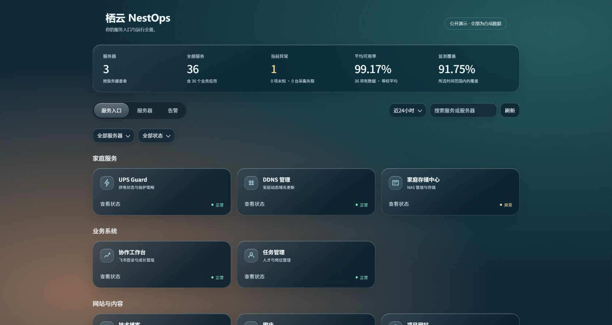
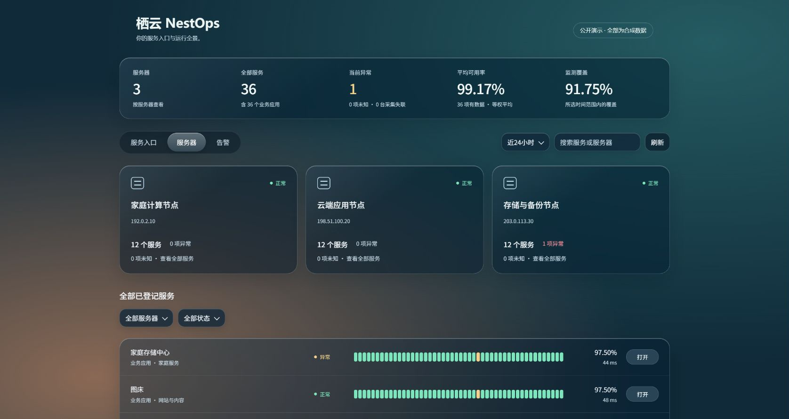
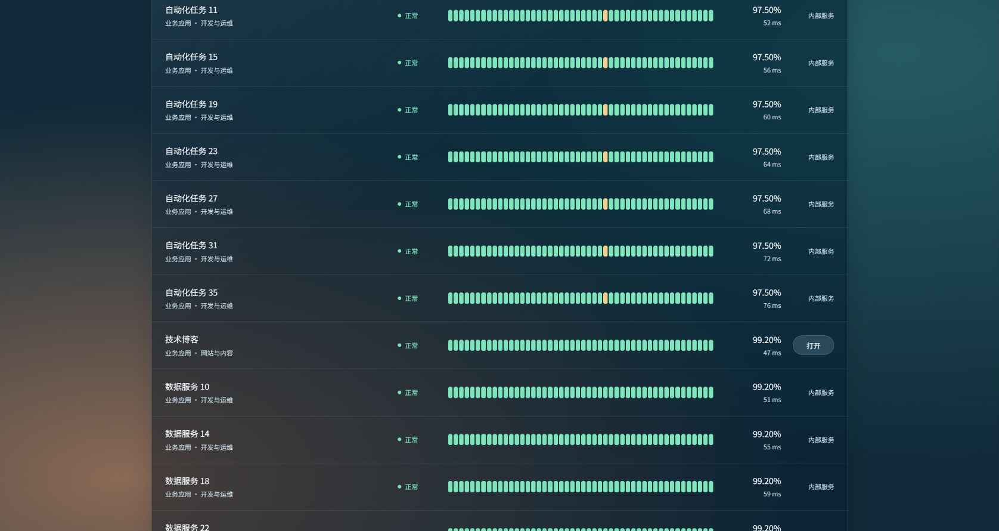
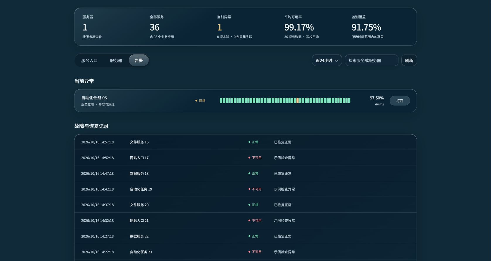

<div align="center">
  
  <h1>栖云 NestOps</h1>
  <p><strong>你的服务入口与运行全景。</strong></p>
  <p>Homepage 驱动的自托管服务门户 · 只读监测 · 可用性历史与告警</p>
  <p>
    <a href="https://github.com/DongLiStudio/nest-ops/actions/workflows/ci.yml"></a>
    <a href="LICENSE"></a>
    
    <a href="https://github.com/DongLiStudio/nest-ops/stargazers"></a>
  </p>
  <p><a href="#快速开始">快速开始</a> · <a href="#界面预览">界面预览</a> · <a href="#架构与边界">架构与边界</a> · <a href="docs/deployment.md">部署指南</a> · <a href="https://github.com/DongLiStudio/nest-ops/issues">反馈问题</a></p>
</div>

---

## 为什么使用 NestOps？

服务散落在不同服务器，收藏夹只能告诉你“从哪里打开”，不能告诉你“最近是否稳定”。NestOps 把入口、固定资产目录、主机采集和历史记录放到同一页：先找到服务，再查看当前状态、所选时间范围的可用率与监测覆盖，最后沿故障与恢复记录定位问题。

基于 [Homepage](https://github.com/gethomepage/homepage) 的轻量运维门户，统一服务导航、服务器资产、可用性监测与异常告警。保留官方 Homepage，使用独立 JS/CSS 扩展，NestOps 本体由一份 Compose 管理；认证中心和共享网关分别独立部署。

适合家庭实验室、自托管工具和小型服务器集群。它不是远程执行平台，也不是完整业务拨测系统；HTTP 可达和进程运行不等于登录、支付等业务全链路正常。

## 功能亮点

- Liquid Glass 服务入口、服务器目录、告警三个视图；筛选、分页、服务详情。
- 固定登记目录：停服和失联仍展示，系统进程默认不登记。
- HTTP 入口检查与宿主只读回传、可用性历史条、响应曲线、事件与恢复记录。
- 原生 Homepage 密码或 OIDC 登录；监测接口验证同一登录会话，每台采集器独立令牌。
- 可选家庭 UPS/DDNS 状态卡片接口；其他定制数据按实际需求接入，不强制插件协议。
- Linux/NAS Python 和 macOS Ruby 采集器；无远程命令执行接口，无中心 Docker socket。
- 全部服务按可用率、覆盖率、名称排序后分页；故障与恢复记录支持按时间范围、服务查询和后端分页。

## 界面预览

以下截图均来自本地合成数据，不含真实服务器、凭据、公网地址或监测历史；示例地址遵循 RFC 5737。点击图片可查看原图。

<p align="center">
  <a href="docs/assets/gallery/services-demo.jpg"></a>
  <a href="docs/assets/gallery/servers-demo.jpg"></a>
  <a href="docs/assets/gallery/availability-demo.jpg"></a>
  <a href="docs/assets/gallery/alerts-demo.jpg"></a>
</p>

详细的预览说明、截图口径和移动端检查见 [界面预览文档](docs/preview.md)。可运行 `python scripts/preview.py` 在本机查看服务入口、排序列表与多页事件。

## 快速开始

需要 Linux 中心服务器、Docker Engine 与 Compose v2、Python 3、可用 HTTPS 域名及证书。仓库不含私人配置。

```sh
cp .env.example .env
# 编辑 .env 中的域名
python3 scripts/init.py
# 编辑 runtime/console/registry.json；按文档配置每台采集器
# 把证书放到 runtime/tls/fullchain.pem 与 privkey.pem
python3 scripts/prepare.py
docker network inspect nestops-edge >/dev/null 2>&1 || docker network create nestops-edge
docker compose config --quiet
docker compose -f compose.gateway.yml config --quiet
docker compose up -d
docker compose -f compose.gateway.yml up -d
docker compose ps
```

初始化生成的登录密码只写入 runtime/homepage.env；不要提交 runtime。登录 https://你的域名 后查看主页。默认示例服务需改成真实配置，未接入时显示未知。

详见 [部署](docs/deployment.md)、[采集器](docs/collectors.md)、[配置与统计口径](docs/configuration.md)、[升级与恢复](docs/maintenance.md)。原生 HomeTunnel 链接是可选集成，需要另外安装对应客户端。

## 架构与边界

```text
浏览器 → 独立 HTTPS 网关 → Homepage / NestOps 只读控制台
                              ↑
                HTTP 检查 + 各主机 HTTPS 采集回传
                              ↓
                    SQLite 历史 → 邮件告警
```

每台采集器使用独立令牌；页面数据复用 Homepage 登录会话。认证中心、共享网关和 NestOps 分开部署，更新门户不需要同时重启认证服务。架构示意不代表所有环境均已验收。

中心服务只提供观察和入口；网页重启、更新和远程命令未实现。监测开始前没有历史数据，未知不计作正常，运行状态不等同于完整业务验收。

部署边界：`compose.yml` 仅包含 Homepage、console、status。`compose.gateway.yml` 管理共享 HTTPS 网关；可选 `compose.auth.yml` 单独管理 Authelia。已有认证中心时直接连接外部 OIDC，无需部署本仓库的认证示例。三组服务分别启动、停止和更新，勿把三个文件通过 `-f` 合并成一个项目。

## 验证与开发

```sh
python3 scripts/verify.py
python3 console/tests.py
python3 scripts/test_collectors.py
node scripts/test_ui.cjs
```

这些是源码、脱敏与离线回归检查；不替代实际 Docker 启动、认证、TLS、浏览器交互和通知送达验收。首次部署应按部署文档逐项检查。

## 参与贡献与交流

欢迎通过 [Issues](https://github.com/DongLiStudio/nest-ops/issues) 报告问题或讨论功能，通过 Pull Request 提交改进。报告中请提供版本、部署方式、复现步骤和预期结果；不要上传令牌、Cookie、私有服务目录、真实服务器地址或未脱敏截图。

提交前运行上面的验证命令；不要修改 `vendor/homepage` 的固定上游源码。部署、源码验证、浏览器验收和正式 Release 是不同状态，功能支持以文档及实际测试为准。

## 相关项目

- [HomeTunnel · 家庭隧道](https://github.com/DongLiStudio/HomeTunnel)：从服务主页打开基于 SSH Agent 的私有 Web 隧道；独立安装，可选集成。
- [Personal Agent Foundation](https://github.com/DongLiStudio/personal-agent-foundation)：可安装、迁移与恢复的个人 Agent 工作基座；不是运行 NestOps 的必要依赖。

## 来源与许可

NestOps 以 GPL-3.0 发布。内附固定版本 Homepage 源码与完整许可证，参见 [UPSTREAM.md](UPSTREAM.md)。Homepage、Authelia、Nginx、Python 及其他第三方组件各自的许可证和署名保持不变。

## Star History

如果 NestOps 对你有帮助，欢迎在 GitHub 点 Star。下图由 [Star History](https://www.star-history.com/) 自动生成，会随仓库公开 Star 数变化更新；点击图表可查看交互版。

<p align="center">
  <a href="https://www.star-history.com/#DongLiStudio/nest-ops&Date"></a>
</p>
